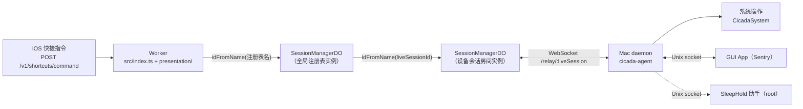

# Cicada 架构与职责

本文按当前代码描述 Cicada 的组成、各部分的职责边界和信任模型。每条描述都标了出处文件，代码变了以代码为准。
命令与快捷指令的细节流程见 [`docs/architecture/command-validation.md`](architecture/command-validation.md)。

## 1. 总览

用户唯一的远程控制入口是 iOS 快捷指令发出的 HTTP 请求。请求经过 Cloudflare Worker，
由 Durable Object 转给在线的 Mac daemon，daemon 在本机执行系统操作后把结果原路返回。
Mac 离线时命令不排队，直接返回失败。

- Worker 入口：`apps/relay/src/index.ts` 创建 `CicadaRelayApp`（`apps/relay/src/presentation/app.ts`），
  并把 `SessionManagerDO` 以 `CicadaSessionManager` 名义导出；`apps/relay/wrangler.toml` 只绑定了这一个 DO 类（`CICADA_SESSIONS`）。
- 同一个 DO 类有两种实例用法：
  - **全局注册表**：用固定名字 `SESSION_CONSTANTS.REGISTRY_DO_NAME`（`apps/relay/src/config/constants.ts`）寻址，只有一个实例。
  - **会话房间**：用 daemon 连接路径里的 `liveSession` 寻址（`apps/relay/src/presentation/controllers/session.controller.ts`），每台在线设备一个。
- DO 内部按路径分派两类请求：`/registry/*`、`/v1/shortcuts/command` 由注册表实例处理，`/shortcut/command` 和 WebSocket 升级由房间实例处理
  （`apps/relay/src/infrastructure/persistence/durable-objects/session-manager.do.ts` 的 `fetch` 分派）。

### 一条快捷指令命令的路径

1. 快捷指令带 `Authorization: Bearer <快捷指令 token>` 调 `POST /v1/shortcuts/command`；Worker 原样转给注册表实例（`SessionController.sendShortcutCommand`）。
2. 注册表对 token 做 SHA-256 哈希，在该设备的授权记录里查找，检查未撤销、未过期、命令在允许范围内、设备在线
   （`session-manager.do.ts` 的 `handleShortcutCommand`、`hashShortcutToken`）。
3. 注册表按设备记录里的 `liveSessionId` 找到房间实例，转发 `/shortcut/command`；房间通过 WebSocket 发 `shortcut_command` 给 daemon。
4. daemon 用本地授权库再检查一次（`apps/agent/swift/Sources/CicadaRelayClient/RelayDaemonService.swift` 的 `processShortcutCommand` → `ShortcutGrantStore.authorize`），
   通过后交给 `MacOSCommandGateway` 执行，回 `shortcut_result`。
5. 结果经房间、注册表、Worker 返回给快捷指令。

## 2. 各部分职责与边界

### 2.1 relay（`apps/relay`，Cloudflare Worker + Durable Object）

| 部分 | 位置 | 职责 |
| --- | --- | --- |
| 入口 | `src/index.ts` | 创建应用实例（同一 isolate 内复用以保留限流计数），导出 DO 类 |
| 中间件管线 | `src/presentation/app.ts`、`src/infrastructure/middleware/` | 依次为 requestId、日志、安全响应头、请求体大小限制（10 KB）、CORS（按 `ALLOWED_ORIGINS` 配置）、限流，最后是路由 |
| 路由 | `src/presentation/router.ts`、`routes/` | `GET /relay/:liveSession`（daemon WebSocket）、`POST /v1/shortcuts/command`、`POST /v1/admin/device-reset`、`GET /status`、`GET /devices`、`GET /health`、`GET /` |
| 控制器 | `src/presentation/controllers/` | 校验 daemon 连接头（设备 ID、身份公钥、登记签名相关头），转发到对应 DO 实例；查询注册表状态 |
| SessionManagerDO | `src/infrastructure/persistence/durable-objects/session-manager.do.ts` | 注册表：设备记录、身份公钥首见绑定、登记签名校验与防重放、快捷指令授权记录、命令授权检查与路由。房间：持有 daemon 的 WebSocket、转发命令、等待结果 |
| 持久化 | 同上 | 用 DO 自带存储（`state.storage`）保存会话、已用 nonce 和注册表记录；没有使用 KV 或 R2（`wrangler.toml` 中均为注释） |

relay 不执行任何系统操作，也不签发快捷指令 token。

### 2.2 packages/shared（协议单一来源）

- 命令清单：`packages/shared/src/protocol/commands.ts` 是 TypeScript 侧命令的唯一来源。
- 中转传输消息类型：`packages/shared/src/types/relay-transport.types.ts`。
- 生成器：根目录 `tools/generate-command-contract.mjs` 读取构建后的 `packages/shared/dist`，
  生成 `packages/shared/protocol/command-contract.json`，并改写 `packages/shared/COMMANDS.md` 中标记区间。
  `bun run protocol:generate` 生成，`bun run protocol:check` 检查生成结果是否已提交（根 `package.json`）。
- 跨语言样例：`packages/shared/protocol/fixtures/*.json`（`shortcut_command`、`shortcut_result_*`、`shortcut_grant_update*`），
  relay 侧由 `apps/relay/test/integration/transport-neutral.test.ts` 使用，Swift 侧由
  `apps/agent/swift/Tests/CicadaRelayClientTests/RelayTransportFixtureTests.swift` 使用，保证两边编解码一致。
- Swift 侧没有代码生成，命令清单在 `apps/agent/swift/Sources/CicadaCore/Models.swift` 手工维护；改协议时要同时改这里和 `CicadaSystem/MacOSCommandGateway.swift`。

### 2.3 Mac 端（`apps/agent`）

SwiftPM 包 `apps/agent/swift/Package.swift`（包名 `CicadaSwift`）产出三个可执行文件和若干库：

| 可执行文件 | target | 运行方式 | 职责 |
| --- | --- | --- | --- |
| `cicada` | `CicadaCLIApp` → `CicadaCLI` | 用户在终端运行 | 管理快捷指令 token、安装/控制各组件；通过 daemon socket 请求 daemon 办事 |
| `cicada-agent` | `CicadaDaemonApp` | LaunchAgent（`~/Library/LaunchAgents/com.cicada.agent.plist`） | 持有到 relay 的 WebSocket（`CicadaRelayClient`），执行命令（`CicadaSystem`），提供 daemon 控制 socket |
| `cicada-sleephold` | `CicadaSleepHoldServiceApp` | 以 root 运行的 LaunchDaemon（`/Library/LaunchDaemons/com.cicada.sleephold.plist`） | 需要提权的防睡眠操作；socket 属主改为安装用户、权限 0600 |

主要库：

- `CicadaCore`：配置、运行路径（`RuntimePaths.swift`）、设备身份（`IdentityStore.swift`）、快捷指令授权（`ShortcutGrant.swift`）、命令模型。
- `CicadaIPC`：本机进程间通信，全部是 Unix domain socket（见下）。
- `CicadaSystem`：命令执行网关 `MacOSCommandGateway` 和各类原生控制器（电源、显示、音频、蓝牙、锁屏、应用等），以及 SleepHold 的安装与调用。
- `CicadaRelayClient`：与 relay 的连接生命周期、消息编解码、登记签名。
- `CicadaUI`：GUI 的界面与状态，被 Xcode 工程引用。
- `CicadaSleepHoldCore`：SleepHold 的会话与电源控制，供助手和 UI 共用。

GUI App：`apps/agent/native/sentinel-app` 下的 Xcode 工程 `Sentry.xcodeproj`（目标 `Sentry`）。
它以本地包方式引用 `../../swift`，只使用其中的 `CicadaUI` 产品；工程本身放 App 生命周期、菜单栏、
告警（AlarmEngine）、摄像头、以及 notifier/sentinel 两个 socket 的服务端（`Sentry/SentinelNotifierServer.swift`、`Sentry/SentinelIPC.swift`）。
三个命令行可执行文件以 helper 形式放在 App 包的 `Contents/Helpers/` 下（`RuntimePaths.swift` 中的 `bundled*HelperPath`）。

**SwiftPM 包 vs Xcode 宿主**：可复用逻辑、命令执行、协议和 UI 组件都在 SwiftPM 包里，可用 `bun run test:agent` 测试；
Xcode 工程只做需要 App 宿主的部分（App 入口、权限相关 Info.plist、摄像头、窗口），以及签名打包（`bun run sign:agent`）。

### 2.4 Mac 端进程间通信（CicadaIPC）

socket 路径定义在 `apps/agent/swift/Sources/CicadaCore/RuntimePaths.swift`：

| socket | 服务端 | 客户端 | 用途 |
| --- | --- | --- | --- |
| `daemon.sock` | daemon（`UdsDaemonControlServer`，权限 0600） | CLI（`UdsDaemonControlClient`） | 创建/列出/撤销快捷指令授权、电源断言、Sentry 开关与状态（`DaemonControl.swift` 的 `DaemonControlAction`） |
| `notifier.sock` | GUI App | daemon（`UdsNotifier`，不可用时尝试拉起 App） | daemon 向用户发通知 |
| `sentinel.sock` | GUI App | daemon 的命令网关、`CicadaUI`（`UdsSentinelControlClient`） | 控制 Sentry 告警功能 |
| `sleephold.sock` | SleepHold 助手 | `CicadaSystem/SleepHoldService.swift`、`CicadaUI`（`SleepHoldControlClient`） | 防睡眠的开始/结束 |

GUI App 的启停由 `CicadaIPC/SentinelAppManager.swift` 通过 `launchctl` 管理。

## 3. 信任模型（现状）

**relay 是可信控制方，不是端到端认证。** 快捷指令走普通 HTTPS，relay 能看到命令名、参数和结果，
并独立决定是否把命令转给 Mac（`docs/architecture/command-validation.md` 的 Security Boundary 一节）。
daemon 收到的是 relay 转来的 `grantId` 而不是 token，所以 Mac 端的二次检查只能确认这个授权在本地仍然有效，
不能独立确认请求确实来自持有 token 的快捷指令。

- **设备身份**：daemon 首次运行时生成 Ed25519 签名密钥对，保存在 `~/.cicada/agent.identity.json`（文件权限 0600，`IdentityStore.swift`）。
- **首次登记（首见绑定）**：daemon 连接时带上设备 ID 和身份公钥。注册表第一次见到某个设备 ID 时直接记录它的公钥；
  之后同一设备 ID 只接受同一公钥，并要求带时间戳、nonce 和签名的登记请求，注册表校验签名、时间窗和 nonce 是否已用过
  （`session-manager.do.ts` 的 `handleRegistryAgentOnline`）。
- **快捷指令 token 与授权（grant）**：由 Mac 本地签发。`cicada` 通过 daemon 创建授权，本地只存 token 的哈希、预览、允许的命令和过期时间
  （`~/.cicada/shortcut-grants.json`，`ShortcutGrant.swift`）；daemon 通过 `shortcut_grant_update` 把这些元数据同步给注册表，
  注册表只能在设备在线时接受更新（`handleRegistryShortcutGrantUpdate`）。relay 和 Mac 都只保存哈希和预览，不保存完整 token。
- **双重检查**：relay 注册表检查一次（第 1 节第 2 步），daemon 本地再检查一次（第 4 步），两边的规则相同：未撤销、未过期、命令在允许范围内。
- **管理员令牌**：`CICADA_ADMIN_TOKEN` 是部署时配置的 Worker 机密，只用于 `POST /v1/admin/device-reset`，
  作用是解除某个设备 ID 的首见公钥绑定，让密钥丢失或更换的设备能重新登记（`apps/relay/src/presentation/routes/admin.route.ts`）。
  未配置时该端点返回 404。

## 4. 已知结构问题与升级方向（计划中）

当前一个全局注册表实例同时承担身份绑定、授权存储和命令路由，所有快捷指令请求都要经过它，职责集中、也是单点。
首次登记只相信第一次见到的公钥，
计划改为由管理员签发一次性注册码，设备凭码完成首次登记。中转协议目前没有运行时版本协商
（`constants.ts` 里的 `VERSION`/`API_VERSION` 只是常量，传输消息里没有版本字段），两端靠同时升级和跨语言样例保持一致。
长期目标是“一台设备一个 DeviceDO”：身份、授权和会话都归到按设备寻址的实例，去掉全局注册表。
以上都是计划，没有排期。
